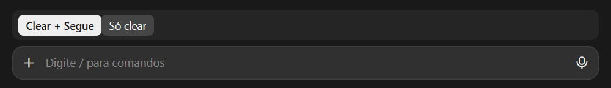
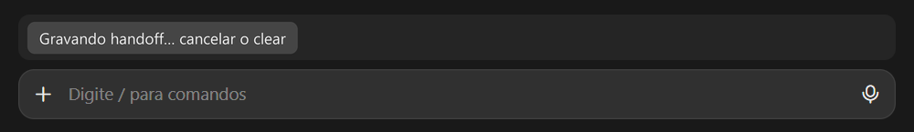
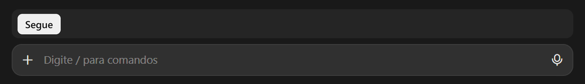
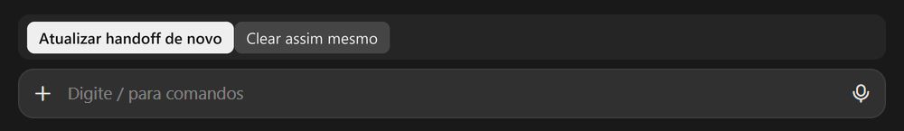

# Clear + Segue

Um botão acima da caixa de mensagem do Claude Code. Um clique faz as três
coisas que você faria à mão quando a conversa fica longa: manda o Claude anotar
onde parou, limpa a conversa e manda continuar.



## Por que usar

Cada mensagem reenvia a conversa inteira. Conversa longa custa mais e o Claude
começa a esquecer o que foi decidido no começo. O remédio é o `/clear`, mas
limpar sem anotar nada joga o trabalho fora. O botão junta as duas pontas: só
limpa depois que existe uma anotação em dia (o *handoff*), e a conversa nova
começa por ela.

## O que cada botão faz

| Botão | O que acontece |
|---|---|
| **Clear + Segue** | Confere o handoff, roda o `/clear` e envia o `segue` sozinho. Você não digita nada. |
| **Só clear** | Confere o handoff e roda o `/clear`. A faixa passa a mostrar **Segue**, para você mandar quando quiser. Serve para limpar e pedir outra coisa. |

O handoff é um arquivo do projeto, `.claude/handoff-<8 primeiros caracteres da
sessão>.md`, com o que foi feito (e a prova), o que falta, o que foi tentado e
descartado e a próxima ação segura.

### Quando o handoff não existe ou está velho

O botão não limpa sem handoff. Se o arquivo não existe, ou se o Claude mexeu em
alguma coisa depois de escrevê-lo, o clique manda o Claude gravar ou atualizar
o arquivo, e o `/clear` sai sozinho quando ele termina. Enquanto isso a faixa
mostra o botão de cancelar:



Ler arquivo, buscar e mexer na lista de tarefas não deixam o handoff velho;
editar arquivo e rodar comando, sim.

### Depois do "Só clear"



O **Segue** fica disponível por 30 minutos, só na pasta do projeto em que você
limpou. Se você digitar qualquer mensagem, ele some.

### Se o handoff continuar velho

Se o Claude terminou o turno sem atualizar o arquivo, o `/clear` é cancelado e
você escolhe:



O `/clear` automático também é cancelado se você interromper o Claude enquanto
ele grava.

> A primeira imagem é um print do aplicativo. As outras três foram desenhadas
> sobre esse print, com os rótulos exatos do código, porque esses estados duram
> poucos segundos na tela.

## Instalar

Precisa do Claude Code atualizado (feito e usado na versão 2.1.330; versões
antigas não têm mods). Funciona sem o resto do Lastro.

### Caminho 1: uma linha, no terminal

Abra o Claude Code no terminal e digite no prompt dele:

```
/plugin install clear-segue --marketplace edubraqd/lastro
```

Responda `y` para adicionar o marketplace e escolha o escopo `user` (vale para
todos os projetos). Feche e abra o Claude Code.

Este caminho segue a documentação do Claude Code, mas ainda não foi testado em
outra máquina. Se não funcionar, use o caminho 2 e abra uma issue.

### Caminho 2: clonar e apontar a pasta (o que o autor usa)

```bash
git clone https://github.com/edubraqd/lastro
```

Abra `~/.claude/settings.json` (no Windows, `C:\Users\<você>\.claude\settings.json`)
e ponha dentro de `"env"` o caminho completo da pasta do mod:

```json
"env": {
  "CLAUDE_CODE_PLUGIN_DIRS": "C:\\caminho\\para\\lastro\\mods\\clear-segue"
}
```

No macOS e no Linux o caminho é do tipo `/home/voce/lastro/mods/clear-segue`.
Se a variável já existe, acrescente a pasta separando com `;` no Windows e `:`
nos outros. Feche o Claude Code por completo e abra de novo.

### Conferir

Abra uma conversa e mande qualquer mensagem. A faixa aparece acima da caixa de
texto **depois da primeira mensagem**, não antes.

## Com o Lastro inteiro fica melhor

Sozinho, o botão funciona: o `segue` manda o Claude ler o handoff. Com os hooks
do Lastro instalados (`python hooks/install.py`, na raiz do repositório), a
conversa nova já nasce com o handoff carregado, sem gastar uma leitura, e o
Lastro avisa quando a conversa está grande o bastante para valer o clique.

## Limites conhecidos

- Os textos que o botão envia ao Claude estão em português.
- Testado no aplicativo de desktop no Windows. No terminal e no VS Code o motor
  é o mesmo, mas ninguém clicou lá ainda.
- A faixa só aparece em conversa aberta depois da instalação.
- O botão procura o handoff na raiz do projeto. Projeto aberto numa subpasta
  tem o handoff nessa subpasta.

## Para quem mexe no código

```bash
claude plugin validate mods/clear-segue
```
```bash
claude plugin test mods/clear-segue
```

São 13 testes dos caminhos do botão (`hooks/register.test.tsx`), rodando contra
o motor do Claude Code com relógio, disco e armazenamento falsos. Eles não
cobrem o `/clear` real nem a pintura da faixa.

Desinstalar: `/plugin uninstall clear-segue` (caminho 1) ou tirar a pasta de
`CLAUDE_CODE_PLUGIN_DIRS` (caminho 2). Os arquivos `.claude/handoff-*.md` ficam
nos projetos; apague à mão se quiser.
